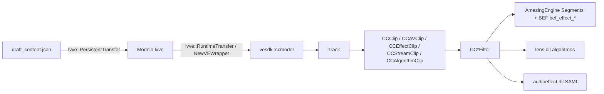
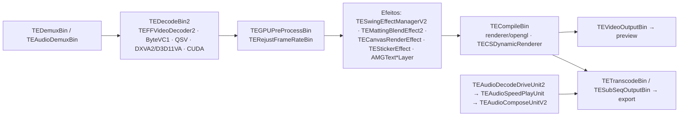

# 2.3 — Motor de Edição de Vídeo (VECreator / videoeditor / cccreator / lens)

> Alvo: CapCut PC 9.6.0.4097. Análise estática + leitura de projetos **do próprio usuário** em
> `%LOCALAPPDATA%\CapCut\User Data\Projects\com.lveditor.draft\` (6 projetos, 2 versões de draft).
> Privacidade: só o **esquema** dos projetos foi registrado (chaves, tipos, faixas numéricas, enums);
> caminhos, nomes de arquivos, textos e ids não entram na documentação.
> Ferramentas: `analise/scripts/draft_schema.py` (esquema dos drafts), `pe_dump.py`/`strings_dump.py`
> (Fase 1 + strings de `cccreator.dll` e `lens.dll` em `analise/fase2/raw/engine/`) e Ghidra 12.1.4
> headless no `videoeditor.dll` (`analise/scripts/ghidra/DraftRefs.java`).

---

## 2.3.1 Funções exportadas de `VECreator.dll`

- 1.808 exports. Único export C: `entryPoint` (ponto de entrada do app chamado pelo `CapCut.exe` da pasta de versão).
- O restante são classes C++ consumidas por plugins/DLLs irmãs:
  - `davinci::effectplatform::heycan` (275) e `::loki` (104) — plataforma de efeitos/recursos (download e cache de efeitos; "heycan" é o mesmo nome do `heycanInfo.json` dos watermarks).
  - `gecko_cpp` (63) — Gecko (sistema de atualização de recursos da ByteDance, `TTPGeckoCppSDK.dll`).
  - `vesdk::ccmodel::*` — o **modelo de clipes e filtros** (catálogo completo em 2.3.6).
- Seções `.vmp0-2` (VMProtect): grande parte do código está virtualizada — por isso a análise de funções no Ghidra foi feita no `videoeditor.dll` (sem VMProtect), não aqui.

Status: concluído (mapa por classe; análise de funções inviável por VMProtect — registrado, não contornado).

## 2.3.2 Funções exportadas de `videoeditor.dll`

- 13.722 exports: **5.536 apenas por ordinal** + nomeados em `lvve::*` (5.720) e `lyra::*`.
- Grupos principais (`lvve` = "LV video editor", núcleo do draft):

| Classe | Exports | Papel inferido |
|---|---|---|
| `lvve::preset` | 312 | Presets de edição (combinações, estilos) |
| `lvve::RuntimeTransfer` | 296 | Conversão draft ↔ objetos de runtime do motor |
| `lvve::PersistentTransfer` | 285 | Conversão draft ↔ JSON persistido |
| `lvve::DraftEnumTransfer` | 186 | Mapeamento de enums do draft (strings ↔ int) |
| `lvve::PlayerWin` / `VPlayerWin` / `IPlayer` | 99 / 11 / 12 | Player de preview no Windows |
| `lvve::Attachment*Control` | ~250 no total | Um controlador por arquivo `attachment_*.json` (PC, Timeline, AIClipper, Template, PluginDraft, Cocreate, LyricsEffect, PromptToText, AigcGenerate...) |
| `lvve::NewVEWrapper`, `VESDKModule` | 27 / 11 | Ponte para o VESDK (`cccreator.dll`) |
| `lvve::DraftQuery`, `DraftUpdate` | 14 / 5 | Consulta/atualização do draft |
| `lyra::AIEdit`, `TextTemplateUtils`, `CaptionKeyWordStyles`, `CaptionCapital` | 123 / 66 / 44 / 18 | Edição assistida por IA e legendas |

Status: concluído.

## 2.3.3 Funções exportadas de `cccreator.dll`

- 7.401 exports. API C (sem mangling) por prefixo: `bef_effect_*` 559, `tl_tensor_*` 242, `bef_swing_*` 230, `bef_info_*` 156, `bef_ae_*` 146, `amazingef_effect_*` 60, `vesdk_player_*` 30, `bef_bingo_*` 28, `ByteVC*` 43, `unqlite_*` 30, `bef_portrait_*` 35, `vesdk_recorder_*` 9.
- C++: `Bach` 1.006 (sistema de algoritmos), `AmazingEngine` 405 (motor de cena/efeitos com Lua), `vesdk::ccmodel` 250, `LENS::FRAMEWORK` 42.
- Módulos internos (diretórios de fonte): `graph/processor`, `processor/video`, `renderer/opengl`, `renderer/renderlib`, `decoder/windows`, `videoeffect/effects`, `AERender/render`, `Render/Layers`, `3D/3DModule`, `AssetModule/Importer`, `Bach/ComputeEngine`, `audioeffect/effects`.

Status: concluído.

## 2.3.4 Estrutura interna de um "Draft" (projeto salvo)

**Formato: JSON em texto (UTF-8)**, não binário. Pasta do projeto:

```
<projeto>/
├── draft_content.json          # timeline principal (cópia da timeline ativa)
├── draft_content.json.bak      # backup
├── draft_meta_info.json        # metadados do projeto (capa, nuvem, flags de origem)
├── draft_settings              # INI: [General] draft_create_time, draft_last_edit_time, real_edit_seconds...
├── draft_agency_config.json    # proxy/conversão de mídia ("agency"), resolução 720
├── draft_virtual_store.json    # índices auxiliares
├── draft_biz_config.json, performance_opt_info.json (pré-combinação de segmentos), key_value.json (metadados de origem de cada material: categoria, busca, VIP, direitos)
├── timeline_layout.json        # layout de docks das timelines
├── attachment_pc_common.json   # linhas-guia, área segura, B-roll, relatório de "AI packaging"
├── template.tmp / template-2.tmp
├── draft_cover.jpg
├── common_attachment/          # attachment_pc_timeline, attachment_id_mapping, attachment_gen_ai_info,
│                               # attachment_script_video, attachment_action_scene, attachment_plugin_draft
└── Timelines/
    ├── project.json            # várias timelines por projeto: main_timeline_id, timelines[{id,name,...}]
    └── <uuid>/                 # uma pasta por timeline, com seu draft_content.json e attachments
```

Raiz da biblioteca: `com.lveditor.draft/root_meta_info.json` → `all_draft_store[]` (id, nome, caminho, tamanho dos materiais, flags).

**`draft_content.json` — topo** (`version: 360000`, `new_version: "187.0.0"`/`"189.0.0"`):

| Campo | Tipo | Observação |
|---|---|---|
| `id`, `name`, `path` | str | id = uuid da timeline |
| `duration` | int | **microssegundos** (ex.: 209.600.000 = 209,6 s) |
| `fps` | float | 30.0 nos projetos analisados |
| `canvas_config` | `{width, height, ratio, background}` | ratio `"original"` |
| `tracks[]` | lista | trilhas (ver abaixo) |
| `materials` | dict de ~57 listas | **todos** os recursos, referenciados por id |
| `keyframes` | `{videos, audios, texts, stickers, effects, filters, adjusts, handwrites}` | keyframes por categoria |
| `config` | dict | índices, legendas/letras (`subtitle_taskinfo`, `lyrics_*`), multi-idioma, `video_mute`, `maintrack_adsorb` |
| `platform`, `last_modified_platform` | dict | app/versão/SO que salvou |
| outros | | `color_space`, `is_drop_frame_timecode`, `render_index_track_mode_on`, `free_render_index_mode_on`, `mixed_track_mode_on`, `relationships`, `time_marks`, `smart_ads_info`, `function_assistant_info` |

**Trilha** `tracks[]`: `{id, type: "video"|"audio"|..., name, flag, attribute, is_default_name, segments[]}`.

**Segmento** `tracks[].segments[]` (principais campos):

| Campo | Significado |
|---|---|
| `material_id` | id do material principal (em `materials.videos`/`audios`/`texts`...) |
| `extra_material_refs[]` | ids de materiais auxiliares (5–8 por segmento): `speeds`, `canvases`, `sound_channel_mappings`, `vocal_separations`, `material_animations`, `placeholder_infos`, `material_colors`, `transitions`, `beats`... |
| `source_timerange {start, duration}` | trecho da mídia de origem (µs) |
| `target_timerange {start, duration}` | posição na timeline (µs) |
| `render_timerange` | intervalo de render (0 quando não usado) |
| `clip {alpha, rotation, scale{x,y}, transform{x,y}, flip{horizontal,vertical}}` | transformação 2D |
| `speed`, `reverse`, `is_loop`, `volume`, `last_nonzero_volume` | reprodução |
| `render_index`, `track_render_index` | ordem de composição |
| `enable_adjust`, `enable_color_curves`, `enable_color_wheels`, `enable_hsl`, `enable_lut`, `enable_video_mask`, ... | liga/desliga de cada bloco de cor/máscara |
| `keyframe_refs[]`, `common_keyframes[]` | keyframes do segmento |
| `hdr_settings {mode, intensity, nits}`, `uniform_scale`, `responsive_layout` | extras |

**Materiais** — 57 categorias, entre elas: `videos` (inclui fotos: `type: "photo"|"video"`), `audios` (`type: "extract_music"`...), `texts`, `text_templates`, `stickers`, `effects`, `video_effects`, `transitions`, `speeds`, `canvases`, `audio_fades`, `audio_effects`, `beats`, `hsl`, `color_curves`, `primary_color_wheels`, `log_color_wheels`, `chromas`, `green_screens`, `common_mask`, `smart_crops`, `smart_relights`, `realtime_denoises`, `vocal_separations`, `loudnesses`, `digital_humans`, `ai_translates`, `ai_text_effects`, `video_trackings`, `video_strokes`, `video_shadows`, `video_radius`, `material_animations`, `placeholder_infos`, `sound_channel_mappings`.

- `materials.videos[]`: `path`, `duration` (µs), `width/height`, `has_audio`, `type`, `crop{...}`, `crop_ratio`, `matting{...}` (recorte por IA), `stable{...}` (estabilização), `video_algorithm{...}`, `reverse_path`, `intensifies_path` (versões pré-processadas), flags de IA/copyright.
- `materials.transitions[]`: `effect_id`/`resource_id` (id numérico do recurso baixado), `name` (localizado), `duration` (µs), `is_overlap`, `path` do pacote do efeito.
- `materials.speeds[]`: `{mode, speed}` (+ curva quando `mode` ≠ 0); `materials.canvases[]`: `{type: "canvas_color"|..., color, blur, image}`.

**Timestamps de projeto** (`Timelines/project.json`): `create_time`/`update_time` em **µs desde a época Unix**.

Status: concluído.

## 2.3.5 Formato "binário" do projeto CapCut

- **Não há formato binário** nos projetos desta máquina: tudo é JSON/INI/JPG.
- Porém o `videoeditor.dll` tem **suporte a cifra de draft**: `[DRAFT_IO_MANAGER] IOFileData::write: encrypt file content`, `IOManagerPrivate::decryptKV2`, `updateCipherFormat`, `jianying_draft_encrypt_v2`, um *key store* por URI (`key_store addKey uri ... cipher_type`) e "pc-compatible crypto key store". Usa **Crypto++** (RTTI: Rijndael/AES, CTR, GCM, RSA, SHA-256, SHA-1, MD5, Base64). Há fallback explícito: `tryDecrypt: decrypt fail, may be raw content` — o leitor aceita arquivo em claro.
- Inferência: a cifra é aplicada em cenários específicos (drafts VIP/`VipDraft::to_parcel_writer`, nuvem, templates comprados), não nos projetos locais comuns. **Nenhuma tentativa de decifrar foi feita** (fora do escopo).

Status: concluído (formato documentado; cifra apenas identificada).

## 2.3.6 Pipeline: Track → Clip → Effect → Filter



- **Draft → modelo:** cada `segment` vira um clip; `extra_material_refs` viram filtros anexados ao clip.
- **Clips** (`vesdk::ccmodel`): `CCClip`, `CCAVClip`, `CCEffectClip`, `CCStreamClip`, `CCAlgorithmClip`.
- **Filtros** (catálogo completo exportado):
  - Vídeo/transformação: `CCTransformFilter`, `CCImageTransformFilter`, `CCVideoCropFilter`, `CCVideoCanvasFilter`, `CCVideoBackgroundFilter`, `CCVideoBlurFilter`, `CCRadiusCornerBorderFilter`, `CCReverseFilter`, `CCPreviewTransformFilter`, `CCPreviewMagnifierFilter`.
  - Animação/transição: `CCVideoAnimationFilter`, `CCVideoTransitionFilter`, `CCStickerAnimationFilter`, `CCMotionBlurFilter`.
  - Cor/efeito: `CCColorHslFilter`, `CCAmazingFilter`, `CCBefEffectFilter`, `CCSwingPostProcessFilter`, `CCSmartLightingFilter`, `CCMakeupFilter`, `CCGreenEditingFilter` (chroma), `CCCustomFilter`/`Pre`/`Post`/`Base`, `CCPluginFilter`.
  - IA/algoritmo: `CCAiCutOutClipFilter` (recorte), `CCObjectTrackerFilter`, `CCVideoStableFilter`/`EX`, `CCLensVFIFilter` (interpolação), `CCLensDeflickerFilter`, `CCLensVideoDenoiseFilter`, `CCDigitalManFilter` (avatar), `CCLeaderSecurityDetectFilter`.
  - Texto/sticker: `CCTextStickerFilter`, `CCInfoStickerFilter` (é o tipo usado pelos watermarks), `CCLayerStickerFilter`, `CCBrushStickerFilter`, `CCScriptStickerFilter`, `CCStickerTemplateFilter`.
  - Áudio: `CCAudioVolumeFilter`, `CCAudioFadeFilter`, `CCAudioCrossFadingFilter`, `CCAudioSpeedFilter`, `CCAudioNoiseFilter`, `CCAudioLoudnessBalanceFilter`, `CCAudioInvertFilter`, `CCAudioPreprocessFilter`, `CCAudioSamiFilter`/`ProcessorFilter`/`AECFilter`, `CCAudioMdspSingleProcessorFilter`.
- **Execução:** `AmazingEngine` organiza a cena em segmentos (`VideoSegment`, `TextSegment`, `StickerSegment`, `StickerBrushSegment`, `EmojiSegment`, `TransitionSegment`, `FeatureSegment`, `ScriptSegment`, `TemplateSegment`, `CustomSegment`).

Status: concluído (por nomes de classes/strings; a ordem exata de aplicação dos filtros exigiria análise dinâmica).

## 2.3.7 Pipeline de renderização: Timeline → Compositor → Encoder

O motor do `cccreator.dll` (prefixo `TE` = TTVideoEditor/VESDK) é um **grafo de "Bins" e "Units"**, no estilo GStreamer:



- Unidades de análise na mesma malha: `TEExtractFrameBin` (extração de frames para IA), `TECommonAlgorithmUnit`, `TESmartStabilizationUnit`, `TEVideoObjectLockUnit`, `TEVideoTrackingUnit`, `TELensAlgoDispatchBin` / `TELensLocalWebAlgorithmUnit` (despacho de algoritmos locais ou em nuvem).
- Texto é renderizado como malha 3D em camadas: `AMGTextFillLayer`, `OutlineLayer`, `ShadowLayer`, `InnerShadowLayer`, `InnerStrokeLayer`, `BloomLayer`, `BackgroundsLayer`, `EmojiLayer`, `MaskLayer` (+ `AMGTextMeshGenerator`).
- Renderização em **OpenGL** (via ANGLE → D3D11) com compute shaders (`TECoreGLCSProgram`).

Status: concluído (topologia por nomes de classes; parâmetros reais exigiriam análise dinâmica).

## 2.3.8 `lens.dll` — engine de algoritmos de vídeo

- **lighten**: compilador/runtime de redes neurais próprio — IR em JSON/tar/dir/mem e **IR "bytenn"** (`ln_irimpl_bytenn.c`, `ln_bytenn_ir.cc`), expansores CPU/CUDA, ops (`ln_opimpl_*_cpu/_cuda`). É quem carrega os modelos `.bytenn` (insumo para 2.4).
- **tensorlight** (`tl_*`): biblioteca de tensores exportada (alocação host/device, cast, GEMM com cuBLAS, ativações).
- **Algoritmos de vídeo** (por diretório de fonte), cada um com backend GPU:

| Módulo | Função | Filtro correspondente |
|---|---|---|
| `VideoVFI` (`VfiMerge`) | Interpolação de frames (câmera lenta suave) | `CCLensVFIFilter` |
| `VideoTraHDR` (`VhdrCover`) | Conversão SDR→HDR | `hdr_settings` do segmento |
| `VideoDeflicker` | Remoção de flicker | `CCLensDeflickerFilter` |
| `VideoDenoiseNN` + `algoNN/NNDenoiseFilterOcl` | Denoise neural (CUDA/OpenCL) | `CCLensVideoDenoiseFilter` / `realtime_denoises` |
| `VideoMotionBlur` (`VmbCumulative*`) | Motion blur | `CCMotionBlurFilter` |
| `VideoAntiShake` (`fsnew_avx`) | Estabilização | `CCVideoStableFilter` / `materials.videos[].stable` |
| `VideoSelectFrame` | Seleção de frames-chave | — |
| `VIDA` (`cvPhaseCorrelate`, `LocalDFT`) | Alinhamento por correlação de fase | estabilização/tracking |
| `FeRecognition` (`FeDetection`) | Detecção de rosto | beauty/tracking |
| `optflow`, `calib3d`, `imgproc` (OpenCV) | Fluxo óptico e geometria | VFI/estabilização |

- Exporta `NvOptimusEnablementCuda` (força a GPU NVIDIA em notebooks híbridos) e importa `fastcv` + D3D11.

Status: concluído.

## 2.3.9 Integração com FFmpeg (`avcodec-61.dll` e cia.)

- **FFmpeg 7.x** (avcodec-61, avformat-61, avutil-59, avfilter-10, swscale-8, swresample-5).
- `cccreator.dll` usa a API moderna completa: demux (`avformat_open_input`, `av_read_frame`, `av_seek_frame`), decode/encode (`avcodec_send_packet/receive_frame`, `avcodec_send_frame/receive_packet`), mux (`avformat_write_header`, `av_interleaved_write_frame`), bitstream filters (`av_bsf_*`), parsers e **filtergraphs** (`avfilter_graph_parse2`, buffersrc/buffersink).
- Também importa **funções internas do HEVC** (`ff_hevc_decode_nal_sps/pps/vps/sei`, `ff_h2645_packet_split`...) → **FFmpeg modificado** pela ByteDance.
- `ffmpeg.dll` exporta `ffmpeg_main`, `ffmpeg_kill`, `setCallback_ffmpeg_progress`: **o próprio CLI do ffmpeg compilado como biblioteca**, chamado com argumentos e progresso por callback (mesma estratégia do LeccorCut, mas em processo).
- Codecs/aceleração paralelos ao FFmpeg: **ByteVC1** (HEVC próprio da ByteDance, `ByteVC1_dec`), **Intel oneVPL/QSV** (`MFXVideoDECODE/ENCODE/VPP_*`), **SVT-AV1** (`svt_av1_enc_*`), DXVA2/D3D11VA, CUDA, `libmp3lame`, `libraw` (RAW de câmera), `ttheif_dec` (HEIC).
- `videoeditor.dll` usa um subconjunto (decode/encode/mux simples + filtergraph) — provavelmente para tarefas utilitárias (extração de áudio, thumbnails, transcodificação de proxy).

Status: concluído.

---

## Análise no Ghidra (`videoeditor.dll`)

Auto-análise completa (66 min, 12 núcleos, 14 GB) + `DraftRefs.java`. Saída bruta: `analise/fase2/raw/videoeditor.draft_refs.txt` (fora do git). Projeto Ghidra no scratchpad da sessão (não versionado).

- **116.459 funções**; 93.585 sem namespace (inclui as 5.536 exportadas só por ordinal). Namespaces com mais funções: `lvve` 2.490, `lvve::RuntimeTransfer` 295, `lvve::PersistentTransfer` 285, `lyra::TextTemplateUtils` 218, `draft_store::DraftStore` 213, `draft_store::StoreWrapper` 204, `lvve::MaterialText` 197, `lyra::AbtestConfig` 194, `lvve::DraftQuery` 182, `lvve::SegmentVideo` 156, `lvve::PlayerWin` 130, `lvve::NewVEWrapper` 104, `lvve::MaterialVideo` 85, `lvve::MaterialAudio` 77, `lvve::KeyframeUtils` 62, `lvve::SegmentAudio` 60. Há clientes por domínio (`VideoClient`, `AudioClient`, `TextClient`, `TemplateClient`, `PlayerClient`, `CommonClient`), que parecem a fachada usada pelo VECreator.
- **1.120 strings ligadas ao draft com referência em código.** Quem lê e grava cada arquivo:

| Arquivo / string | Função(ões) no `videoeditor.dll` |
|---|---|
| `draft_content.json` | `draft_store::DraftStore::DraftStore`, `DraftStoreManager::importLocalDraftStore`, `::readFromMetaInfo`, `::findDraftStoreFromPath`, `DraftStore::repairOldDraft`, `StoreWrapperInitInfo` |
| `template.tmp` | `draft_store::DraftStore::saveDraftJsonSync` — o salvamento grava primeiro num arquivo temporário (inferência: escrita atômica temp → rename, o que explica os `template*.tmp` nas pastas) |
| `draft_meta_info.json` | `DraftStore::open`, `::saveDraftMetaInfoJson`, `::getDraftMetaJsonFile`, `DraftUtil::getDraftMetaInfoJson`, `DraftStoreManager::isDraftFoldValid` |
| `root_draft_meta_info.json` | `draft_store::DraftStoreManager::DraftStoreManager` (índice global da biblioteca) |
| `draft_info.json` | `DraftStore::repairOldDraft` — formato legado convertido na abertura |
| `/draft_settings` | `DraftStore::getDraftSettingsPath` |
| `project.json` (multi-timeline) | `draft_store::StoreWrapper::CheckIsExistProjectStore`, `::getAllMultiTimelineDir` |
| `cloud_draft_content.diff.json` | `draft_store::DraftRestoreCloudStore::process_draft_json` — sincronização com a nuvem por **diff**, não pelo arquivo inteiro |
| `old_draft_info` / `new_draft_info` | `draft_store::DraftActionParam::fromString`, `DraftStoreActionParam::writeToJson` (histórico de ações) |

- **Cifra** — funções identificadas, **não decompiladas** (fora do escopo): `IOManagerPrivate::tryDecrypt` (`FUN_18127ebf0`, com o fallback "may be raw content"), `IOManagerPrivate::decryptKV2` (`FUN_18127f320`), `IOFileData::initData` (`FUN_181286190`), `VipDraft::from_parcel_reader` / `to_parcel_writer` (`FUN_180fd0a60` / `FUN_180fd1f50`). Confirma o que as strings indicavam: o leitor tenta decifrar e, se falhar, usa o conteúdo em claro.
- **Migração de versão:** `business_migration_manager.cpp` (`FUN_18100d820`, "migration: task from {} to {}") executa tarefas de upgrade encadeadas; `migrationNeedUpgrade` / `migrationDraftUpgrade` (`FUN_1811deb40`) comparam o `new_version` do draft; `VipDraft::from_parcel_reader` também migra. Há ainda uma migração de cor separada (`colormigration`).
- Os caminhos de fonte embutidos (`C:\90741\CapCutPC\jianying_build\CPM_current\videoeditor\lyra\generated\...`) mostram que boa parte do modelo do draft é **código gerado** a partir de um schema (`lyra/generated/draft`, `lyra/generated/attachment/model`).

Status: concluído (mapa de I/O, cifra e migração; corpos das funções de cifra deliberadamente não analisados).

## Aplicação ao LeccorCut

| Achado | Uso sugerido |
|---|---|
| Draft = JSON com `tracks → segments → material_id + extra_material_refs`, tempos em µs | Base para um **importador `.lccut` ← CapCut** (Fase 5.3) e para evoluir o `.lccut` (materiais por id, segmentos referenciando) |
| `source_timerange` × `target_timerange` | Mesmo modelo do LeccorCut (`in`/`duration` × posição); conversão direta |
| Catálogo `CC*Filter` | Lista de recursos a priorizar (VFI, deflicker, denoise, estabilização, motion blur) |
| `lens.dll` VFI / AntiShake / Deflicker | Equivalentes FFmpeg: `minterpolate`, `vidstabdetect/transform`, `deflicker`, `nlmeans/hqdn3d` |
| `ffmpeg_main` como biblioteca | Confirma a abordagem do LeccorCut (FFmpeg por argumentos + progresso) |
